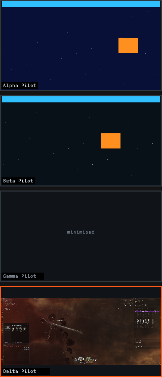

# eveo — EVE-O Preview for Linux

Live thumbnail previews of multiboxed EVE Online clients, for Linux/Arch with
X11 or Wayland (tested on KDE Plasma 6 / kwin_wayland, CachyOS).

Each running client gets a small always-on-top preview showing what that client
is actually doing, right now. Click a preview to switch to that client. Drag to
move it, scroll to resize it — positions are remembered per character.



## Why the other ports don't work

EVE runs under Wine/Proton, so its windows are **XWayland** windows even on a
Wayland session. That part is fine — they can be captured with the X11
Composite extension.

The real problem is **fullscreen mode**. A fullscreen Direct3D window under
Proton minimises itself the moment it loses focus. A minimised X11 window is
unmapped, and the X server renders nothing at all for an unmapped window —
there are no pixels to preview, and no tool on any platform can invent them.
So with clients in fullscreen, at most one client is ever capturable (the
focused one), and the instant you look at something else, every preview dies.

**Set every client to windowed mode.** In game: `Esc` → `Display & Graphics` →
`Display Mode` → **Fixed Window** (or Windowed). The clients then stay mapped
when they lose focus, and previews stay live.

### ...and why previews end up *behind* the client

Fixed Window still covers the whole monitor, so Wine tags the window
`_NET_WM_STATE_FULLSCREEN` anyway. KWin puts the *active* fullscreen window in
its `ActiveLayer`, which sits above the `AboveLayer` that "keep above" windows
live in. An ordinary always-on-top preview is therefore correctly drawn behind
the client you are playing — so clicking a preview looks like it makes all the
previews disappear.

eveo draws previews as **unmanaged (override-redirect) windows** by default.
Those are outside that layer system entirely and stay visible above the active
client. If you run EVE in a window genuinely smaller than the monitor you can
set `override_redirect = false` to get normal managed windows instead.

You can check what eveo sees at any time:

```bash
eveo --list
```

```
  Gamma Pilot                  0x07400001  3440x1440  visible  (active)
  Delta Pilot                  0x08200001  3440x1440  MINIMISED
```

Anything reported as `MINIMISED` is still in fullscreen mode and will show a
placeholder tile instead of a live image.

## Build and install

Needs only the X client libraries, which are already present on any desktop
Arch system:

```bash
sudo pacman -S --needed base-devel libxcb
```

```bash
make
sudo make install        # installs to /usr/local/bin/eveo
```

## Usage

```bash
eveo                   # start the previewer
eveo next              # switch to the next client
eveo prev              # switch to the previous client
eveo activate Gamma    # switch to the client matching a name
eveo --list            # show detected clients and exit
eveo reload            # re-read the config file
eveo quit              # stop a running instance
```

Mouse, on any preview:

| Action | Result |
| --- | --- |
| Left click | switch to that client (restores it if minimised) |
| Left drag | move the preview; position saved per character |
| Scroll | resize the preview; size saved per character |

### Hotkeys

Wayland deliberately forbids applications from grabbing keys globally, so eveo
does not try. Instead, bind the subcommands as normal KDE shortcuts:

*System Settings* → *Keyboard* → *Shortcuts* → *Add Command* →
`eveo next`, then assign a key.

Do the same for `eveo prev`, or for `eveo activate <character>` if you want one
key per character. This works from inside the game because KWin handles the
shortcut before the key ever reaches the client.

### Start automatically

```bash
cp contrib/eveo.service ~/.config/systemd/user/
systemctl --user enable --now eveo
```

## Configuration

Optional, at `~/.config/eve-o-preview/eveo.conf`. Copy `eveo.conf.example` to
get started; every key has a sensible default, so an empty file is fine.

```ini
thumbnail_width    = 320
thumbnail_height   = 180
fps                = 10          # capture rate; 5 is plenty for scouting
border             = 2
color_active       = ff5c1a      # border of the focused client
color_inactive     = 303840
hide_active_client = false       # hide the preview of the client you're on
show_label         = true
label_scale        = 1
opacity            = 1.0
snap               = 0           # snap-to-grid in px while dragging, 0 = off
match_prefix       = EVE -       # window title prefix identifying a client
ignore             = EVE Online Launcher
```

Thumbnail positions are stored separately in
`~/.config/eve-o-preview/positions.conf` and rewritten as you drag, so your
hand-written config is never clobbered.

## How it works

* Clients are found by walking the X window tree for windows that carry
  `WM_STATE` and whose title starts with `match_prefix`.
* Each client's contents come from `XCompositeNameWindowPixmap`. The pixmap
  tracks the window live, so it is taken once and only re-taken when the client
  is resized or remapped.
* Scaling is done by **XRender** directly into an offscreen buffer, so the
  3440×1440 source is scaled on the GPU and never crosses the X socket. Cost is
  a few hundred microseconds per preview per frame regardless of source size.
* Previews are undecorated and unmanaged (override-redirect) by default, so no
  compositor layer policy can push them behind a fullscreen client. In managed
  mode they are instead `_NET_WM_STATE_ABOVE`, skip-taskbar, on all desktops,
  and carry `WM_HINTS` with `input = False`, so clicking one can never steal
  keyboard focus from the game.
* Switching sends `_NET_ACTIVE_WINDOW` with source indication `2` ("pager"),
  which is what lets KWin bypass focus-stealing prevention and also restores a
  minimised client.
* Default preview placement is RandR-aware: on a multi-monitor desktop the X
  screen is the bounding box of every output, so its top-left corner is often
  dead space that is not displayed on any physical monitor. Previews are placed
  relative to the output the client is actually on.

## Development

`tools/fake-client` is a stand-in EVE window, so the previewer can be developed
and tested without running the game:

```bash
make fake-client
./fake-client "Test Pilot One" &
./fake-client "Test Pilot Two" &
./eveo
```

`tools/genfont.py` regenerates `src/font.h`, the embedded label font. Labels use
a built-in bitmap font because modern systems ship no core X bitmap fonts, and
depending on the X font path would make labels fail on a default install.

## Limitations

* A client left in true fullscreen mode minimises itself when it loses focus
  and cannot be previewed at all (see above). Use Fixed Window.
* Because previews are unmanaged they float above *everything*, including other
  fullscreen applications, and they ignore virtual desktops. Set
  `override_redirect = false`, or stop eveo, if that gets in the way.
* Previews show a `minimised` placeholder rather than a stale frame — X11
  discards the contents of unmapped windows, so a last-known frame isn't
  available to show.
